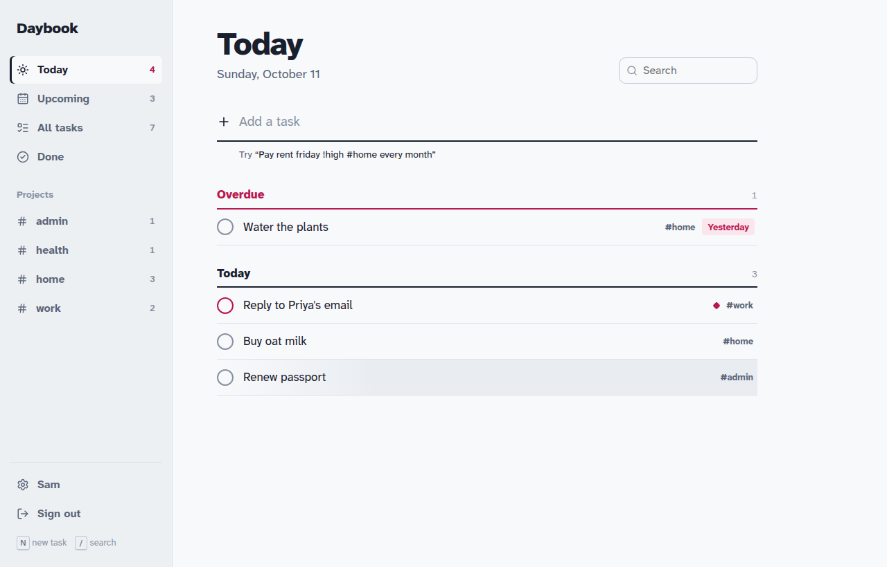
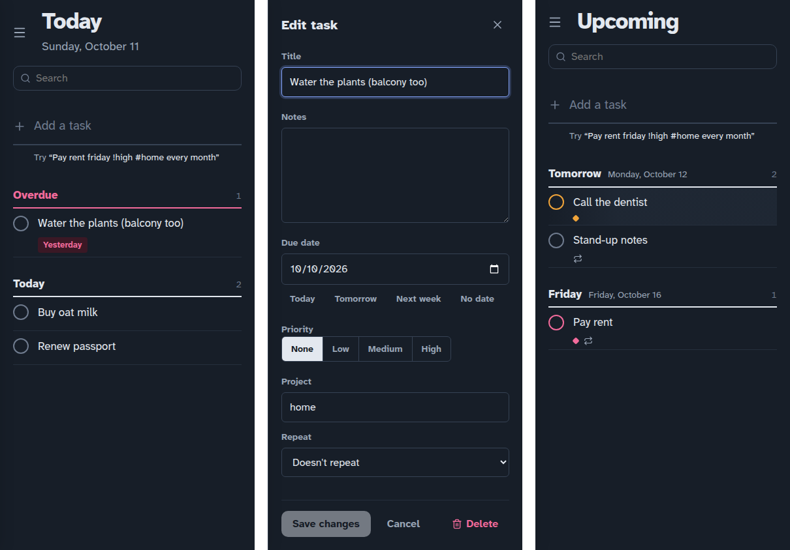

# Daybook

A calm, keyboard-friendly to-do app for everyday tasks, built on the MERN stack (MongoDB, Express, React, Node).

Type a task the way you'd say it, for example `Pay rent friday !high #home every month`, and Daybook picks out the due date, priority, project and repeat for you.





## Features

- **Today, Upcoming, All tasks and Done views.** Overdue tasks are pulled to the top of Today, and Upcoming groups tasks by day.
- **Projects.** Tag a task with `#name` and it gets its own page in the sidebar.
- **Due dates, priorities and repeats.** Completing a repeating task schedules the next one automatically (daily, weekdays, weekly or monthly).
- **Undo** after completing or deleting a task.
- **Search** across titles, notes and projects.
- **Keyboard shortcuts:** <kbd>N</kbd> new task, <kbd>/</kbd> search, <kbd>Esc</kbd> close, <kbd>Ctrl/Cmd</kbd>+<kbd>Enter</kbd> save in the editor.
- **Light and dark themes**, plus a mobile layout.
- **Account security:** optional two-factor sign-in with an authenticator app and recovery codes, password change, sign out everywhere, and account deletion.

### Quick-add syntax

| Type this | Means |
|---|---|
| `today`, `tomorrow`, `yesterday` | Due date |
| `monday` … `sunday` (or `mon`, `fri`) | The next one of that weekday |
| `next week`, `in 3 days` | Relative date |
| `oct 20`, `2026-10-20` | Exact date |
| `!high`, `!medium`, `!low` (or `!1`, `!2`, `!3`) | Priority |
| `#project` | Project |
| `daily`, `every weekday`, `weekly`, `every month` | Repeat |

A preview under the box shows what was understood before you press Enter.

## Deploying on Vercel

One repo, two Vercel projects (import it twice; the settings in `vercel.json` cover both):

| Project | Environment variables | Result |
| --- | --- | --- |
| **Demo** (Root Directory `frontend`) | none (`frontend/vercel.json` builds with `VITE_DEMO=true`) | Static front end with an in-browser stand-in for the API (`frontend/src/lib/demoApi.js`). Tasks live in localStorage. No database. |
| **Live** | `MONGODB_URI`, `JWT_SECRET`, `NODE_ENV=production` | The Express API in `backend/` runs as a Vercel Function (`api/index.js`) on the same domain as the front end, so cookies stay first-party. |

For the live project, use a MongoDB Atlas cluster and allow access from anywhere (`0.0.0.0/0`) in Atlas Network Access, because Vercel functions don't have fixed IPs. Keep a strong, unique database user password. After deploying, `https://<your-app>/api/health` should return `{"ok":true}`.

## Getting started

### Requirements

- Node.js 22.9 or newer
- MongoDB 6+ running locally, or a free [MongoDB Atlas](https://www.mongodb.com/atlas) cluster

### 1. Install

```bash
git clone https://github.com/<you>/daybook.git
cd daybook
npm install
```

This installs both the backend and the frontend (they are npm workspaces).

### 2. Configure

```bash
cp backend/.env.example backend/.env
```

Open `backend/.env` and set:

- `MONGODB_URI`: for example `mongodb://127.0.0.1:27017/daybook` for a local database, or your Atlas connection string.
- `JWT_SECRET`: a long random value. Generate one with:
  ```bash
  node -e "console.log(require('crypto').randomBytes(48).toString('base64url'))"
  ```

The server refuses to start if either is missing, or if the secret is short or a placeholder.

### 3. Run in development

```bash
npm run dev
```

This starts the API on http://localhost:4000 (restarting on changes) and the app on **http://localhost:5173**. Open the second one.

### 4. Run in production

```bash
npm run build                    # builds the frontend into frontend/dist
NODE_ENV=production npm start    # the API serves the built app on one origin
```

Then open http://localhost:4000. In production, cookies are automatically marked `Secure`, so serve the app over HTTPS.

## Deploying

The simplest setup is a single Node service (Render, Railway, Fly.io, a VPS) that runs `npm install && npm run build` and then `npm start`, with a MongoDB Atlas database. Set these environment variables on the host:

| Variable | Value |
|---|---|
| `NODE_ENV` | `production` |
| `MONGODB_URI` | Your Atlas connection string |
| `JWT_SECRET` | A long random secret (never reuse the one from development) |
| `TRUST_PROXY` | `1` if the host puts a proxy or load balancer in front of the app |

Because the API serves the frontend itself, you don't need any CORS configuration.

**Frontend and API on different sites** (for example the frontend on Vercel and the API on Render): set `VITE_API_URL` when building the frontend, and on the API set `CLIENT_ORIGIN` to the frontend's URL, `COOKIE_SAMESITE=none` and `COOKIE_SECURE=true`.

## Testing

```bash
npm test
```

The test suite (39 tests) runs against a real MongoDB at `mongodb://127.0.0.1:27017/daybook_test`, or at `TEST_MONGODB_URI` if set. It covers the task API and every security control. GitHub Actions runs the dependency audit, the build and the tests on every push (`.github/workflows/ci.yml`).

## Security

The app was reviewed against a 20-point full-stack security checklist. Results, with the test that proves each one, are in [`security-ledger.md`](security-ledger.md). In short:

- **Sessions:** signed tokens in `httpOnly`, `SameSite` cookies. JavaScript can't read them, and they're never put in local storage.
- **CSRF protection** on every request that changes data.
- **Privacy between users:** every task query is scoped to the signed-in user, so other users' tasks can't be read or changed.
- **Passwords** are hashed with bcrypt (cost 12).
- **Abuse limits:** rate limiting on the API, with stricter limits on sign-in and account changes.
- **Input validation** on every request, which also blocks MongoDB operator injection.
- **Browser protections:** CORS allow-list, security headers via helmet, and no source maps in production.
- **Two-factor sign-in** is optional, with single-use recovery codes.
- **Clean logs:** they never contain passwords, tokens, emails or request bodies.

If you find a security issue, please open a private security advisory on GitHub rather than a public issue.

## Project structure

```
backend/
  src/
    app.js            Express app: security middleware and routes
    server.js         Entry point: loads config, connects, listens
    config.js         Environment validation
    middleware/       Session, CSRF, rate limits, validation, errors, logging
    models/           User and Task schemas
    routes/           auth, account (2FA, password, delete), tasks
    lib/              Passwords, 2FA, recurrence, logger
  tests/              API and security tests (node:test + supertest)
frontend/
  src/
    pages/            Sign-in/sign-up and the main tasks page
    components/       Sidebar, quick add, task row, editor, settings, toasts
    lib/              API client, auth state, dates, quick-add parser, views
scripts/dev.js        Runs API and frontend together
```

## API overview

All routes are under `/api`. Requests that change data need the `X-CSRF-Token` header (get the token from `GET /api/auth/csrf`).

| Method and path | Purpose |
|---|---|
| `POST /auth/register`, `POST /auth/login`, `POST /auth/logout` | Account access (login returns `{ mfaRequired: true }` when a code is needed) |
| `GET /auth/session` | Current user, or `null` |
| `GET /tasks?status=open\|done\|all` | List your tasks |
| `POST /tasks`, `PATCH /tasks/:id`, `DELETE /tasks/:id` | Create, update or complete, delete |
| `POST /tasks/clear-completed` | Delete all completed tasks |
| `PATCH /account/profile`, `POST /account/password`, `POST /account/logout-everywhere`, `DELETE /account` | Account settings |
| `POST /account/mfa/setup`, `/mfa/enable`, `/mfa/disable` | Two-factor sign-in |
